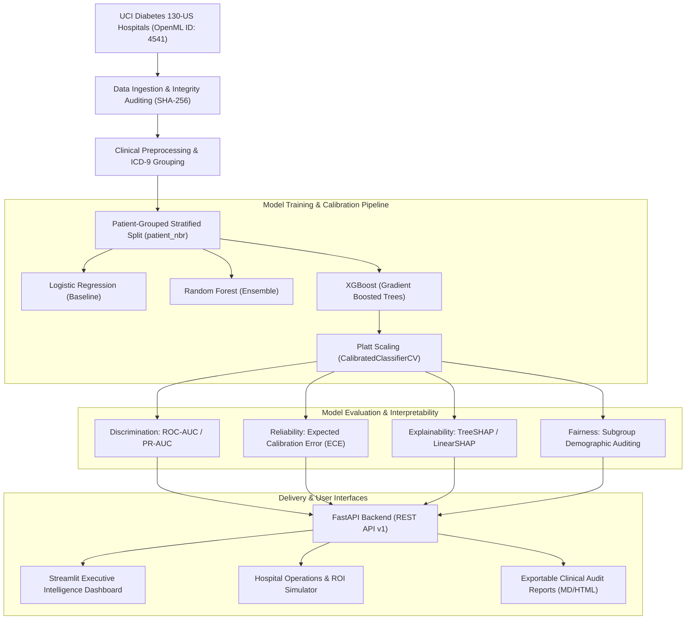

# CARE-PULSE AI — System Architecture & Design Specification

## 1. High-Level Architectural Overview

**CARE-PULSE AI** is an end-to-end, explainable healthcare analytics and patient 30-day readmission risk prediction platform. It bridges data science rigor with hospital operations, combining calibrated machine learning, epidemiological risk assessment (Odds Ratios, Chi-Square tests), TreeSHAP interpretability, and hospital bed capacity forecasting.

---

## 2. Component Structure

### 2.1 Backend Core (`app/`)
- **`app/main.py`**: FastAPI application entrypoint with lifespan validation, CORS, OpenAPI documentation (`/docs`, `/redoc`), and global error handling.
- **`app/config.py`**: Centralized configuration via `pydantic-settings`, providing clinical thresholds, directories, and financial assumptions.
- **`app/api/`**: Modular REST endpoints partitioned by domain:
  - `health.py`: Readiness, liveness, and hardware diagnostics.
  - `dataset_routes.py`: Data summaries, SHA-256 fingerprint, schema audits, column profiling.
  - `analytics_routes.py`: Epidemiological Odds Ratios, continuous metric testing, correlation matrices.
  - `model_routes.py`: Benchmark metrics, ROC/PR curves, reliability curves, real-time single and batch prediction.
  - `explanation_routes.py`: Global SHAP rankings and patient-level waterfall contributions.
  - `report_routes.py`: Executive and clinical audit generation, operational ROI simulation.
- **`app/schemas/`**: Strongly-typed Pydantic schemas validating API inputs and outputs.
- **`app/services/`**: Pure Python domain service classes encapsulating business logic:
  - `data_loader.py`, `data_validation.py`, `preprocessing.py`, `eda_service.py`, `statistics_service.py`, `training_service.py`, `evaluation_service.py`, `calibration_service.py`, `explainability_service.py`, `subgroup_analysis.py`, `uncertainty_service.py`, `prediction_service.py`, `operations_service.py`, `reporting_service.py`.
- **`app/persistence/`**: SQLite-backed experiment tracking (`artifacts/experiments.db`).

### 2.2 Frontend Dashboard (`ui/`)
- **`ui/dashboard.py`**: Streamlit application entrypoint styled with custom healthcare dark theme CSS.
- **`ui/api_client.py`**: Resilient client bridging the UI to FastAPI with transparent in-process fallback if running standalone.
- **`ui/pages/`**: 8 focused interactive analytics views:
  1. `overview.py`: Executive metrics, cohort prevalence, provenance.
  2. `data_explorer.py`: Missingness distributions, target breakdown, interactive table.
  3. `statistical_analysis.py`: Interactive Plotly forest plot of Odds Ratios, Chi-Square testing widget.
  4. `model_lab.py`: Algorithm comparison, operational threshold slider, single-patient simulation sandbox.
  5. `explainability.py`: Population-wide SHAP importance, patient archetype waterfalls.
  6. `reliability.py`: Reliability diagrams, ECE reduction analysis, demographic fairness parity.
  7. `hospital_analytics.py`: Nurse transition care ROI simulator, bed occupancy forecasting.
  8. `reports.py`: Configurable report generator with downloadable Markdown audits.

---

## 3. Data Flow & Security Principles

1. **Patient Leakage Prevention**: Split indices are computed by grouping `patient_nbr` so multiple encounters from the same patient never leak across training and test sets.
2. **Clinical Exclusions**: Patients who expired or entered hospice during hospitalization (`discharge_disposition_id` in 11, 19, 20, 21) are removed prior to training because 30-day readmission is not possible.
3. **Artifact Integrity**: All serialized models (`.joblib`) and benchmark summaries (`.json`) are stored with SHA-256 data fingerprints in `artifacts/`.
